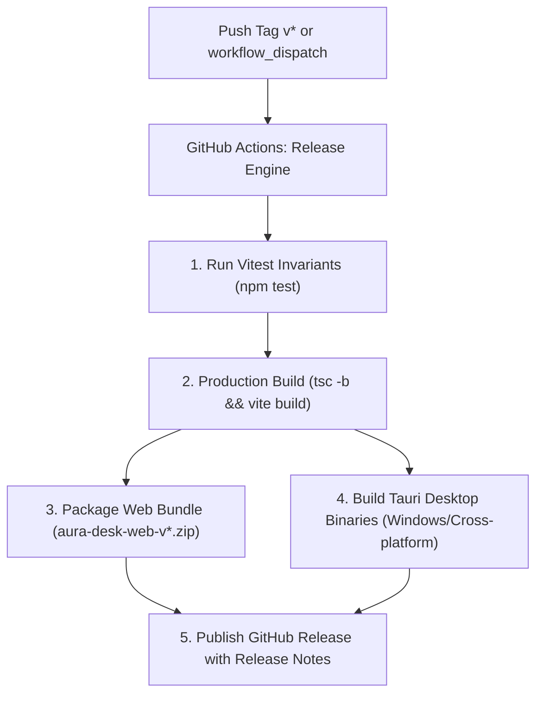

# Aura Desk - Git Versioning & Release Engineering Manifesto

This document outlines the versioning strategy, branch workflow, release automation engine, rollback protocols, and security invariants governing the **Aura Desk** repository.

---

## 1. Semantic Versioning Specification (SemVer 2.0.0)

Aura Desk strictly complies with [Semantic Versioning 2.0.0](https://semver.org/):

$$\text{MAJOR}.\text{MINOR}.\text{PATCH}[-\text{PRERELEASE}]$$

### Version Format: `X.Y.Z`
- **`MAJOR` (X)**: Incremented when incompatible API changes, breaking database/Firestore schema migrations, or fundamental UI/workflow overhauls are introduced.
- **`MINOR` (Y)**: Incremented when new features, screens, or non-breaking functional enhancements are added (e.g., adding multi-image carousels, new project types, or settings modals).
- **`PATCH` (Z)**: Incremented when backward-compatible bug fixes, performance optimizations, or ergonomic refinements are applied (e.g., scrollbar fixes, date formatting tweaks).
- **`PRERELEASE`**: Tagged suffixes for testing and checkpoints (e.g., `v1.0.0-rc.1`, `v1.0.0-beta.2`).

---

## 2. Tagging Conventions

| Tag Pattern | Purpose | Example | Trigger Action |
| :--- | :--- | :--- | :--- |
| `vX.Y.Z` | Production GA Release | `v1.0.0`, `v1.1.0` | Triggers GitHub Actions Release Engine |
| `vX.Y.Z-rc.N` | Release Candidate | `v1.0.0-rc.1` | Automated CI test & staging build |
| `v*-test` | Architectural Checkpoint | `v1-test` | Safe local snapshot / rollback reference |

All official release tags **must be annotated tags**:
```bash
git tag -a v1.0.0 -m "Release v1.0.0 - Aura Desk Public Launch"
```

---

## 3. Branching Strategy & Lifecycle Flow

```
 master (Production Stable) ──────────────────────────●───────● (v1.0.0)
                                                     ▲       ▲
 develop (Active Integration) ──●───────●───────────● (Merge)│
                                ▲       ▲                    │
 feat/* or fix/* ───────────────●───────┘                    │
                                                             │
 hotfix/* ───────────────────────────────────────────────────┘
```

1. **`master` / `main`**:
   - Represents production-ready, verified state.
   - Direct commits to `master` are reserved for release cuts and documentation.
   - Every commit tagged with `v*` on `master` automatically triggers the Release Engine.
2. **`feat/*`**:
   - Isolated branches for specific capabilities (e.g., `feat/image-carousel`, `feat/global-settings`).
3. **`fix/*`**:
   - Bug fix branches resolving triaged issues.
4. **`hotfix/*`**:
   - Urgent patches branched directly from the latest release tag.

---

## 4. Release Engine Architecture

Aura Desk features an automated dual-target CI/CD Release Engine powered by GitHub Actions:



### Pipelines Overview:
1. **`.github/workflows/ci.yml`**:
   - Runs on every push and pull request to `master` and `main`.
   - Executes dependency install, unit/invariant testing (`npm test`), and production build verification (`npm run build`).
2. **`.github/workflows/release.yml`**:
   - Automatically triggered on push of tags matching `v*` or manual `workflow_dispatch`.
   - Packages standalone Web distribution (`aura-desk-web-vX.Y.Z.zip`).
   - Compiles Tauri 2 native desktop binaries.
   - Creates GitHub Release with auto-generated changelog and attached assets.

---

## 5. Cutting a Release Step-by-Step

Aura Desk includes a standardized release script: `scripts/release.sh`.

### Automatic Release Command:
```bash
# 1. Run local verification and dry-run
npm run release -- --dry-run

# 2. Cut release tag locally (e.g. 1.0.0)
npm run release -- 1.0.0

# 3. Cut release and automatically push to GitHub
npm run release -- 1.0.0 --push
```

### Manual Release Steps:
1. Ensure working directory is clean:
   ```bash
   git status
   ```
2. Run test invariants and production build:
   ```bash
   npm test
   npm run build
   ```
3. Update `package.json` and `src-tauri/tauri.conf.json` versions.
4. Commit version synchronization:
   ```bash
   git commit -am "chore(release): cut v1.0.0"
   ```
5. Tag the release:
   ```bash
   git tag -a v1.0.0 -m "Release v1.0.0 - Aura Desk"
   ```
6. Push to GitHub to trigger the Release Engine:
   ```bash
   git push origin master --tags
   ```

---

## 6. Rollback Protocols

If an unintended regression escapes to production, the repository provides two rollback mechanisms:

### Scenario A: Reverting to Checkpoint Tag (`v1-test`)
To inspect or revert the workspace to the `v1-test` checkpoint:
```bash
# Temporary inspection without changing branch
git checkout v1-test

# Or create a hotfix branch based on v1-test
git checkout -b hotfix/from-v1-test v1-test
```

### Scenario B: Production Revert on `master`
To safely revert a problematic commit while preserving linear git history:
```bash
# Revert the faulty commit
git revert <commit-hash>
git push origin master

# Cut an expedited patch release (e.g. v1.0.1)
npm run release -- 1.0.1 --push
```

---

## 7. Security & Secret Quarantine Policy

To maintain compliance and prevent data leaks in public repositories:
- **`users.json`**: NEVER tracked. Contains Firebase Auth exports and user records.
- **`.env*`**: NEVER tracked. Environment credentials, API keys, and local configs must use `.env.example`.
- **`agy-feedback.json` & `agy-triage.json`**: Ignored local runtime telemetry.
- **`src-tauri/target/`**: Excluded compilation cache and binaries.

Before any push, verify that `.gitignore` isolates all sensitive files:
```bash
git status --ignored
```
